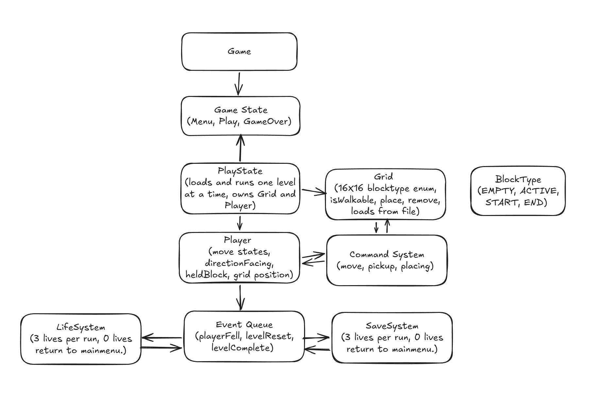
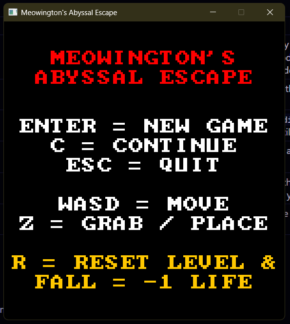
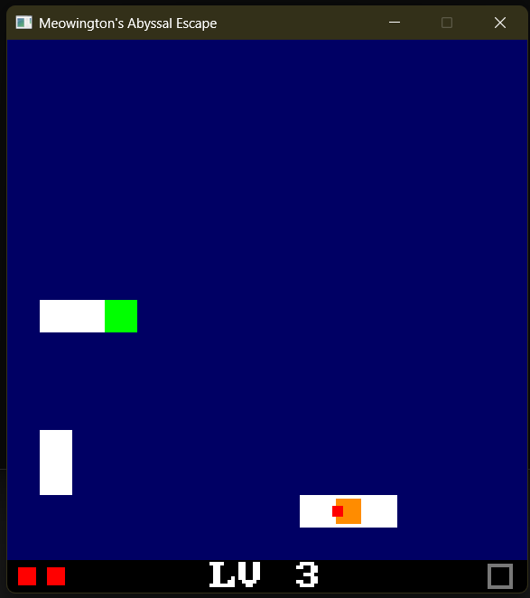
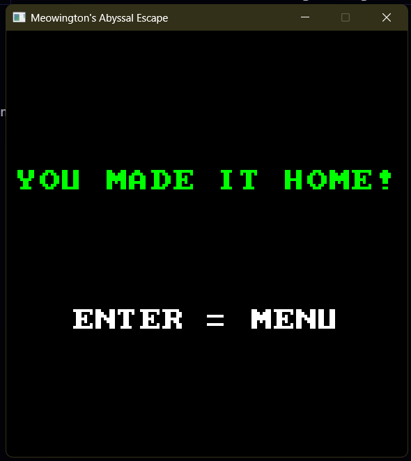
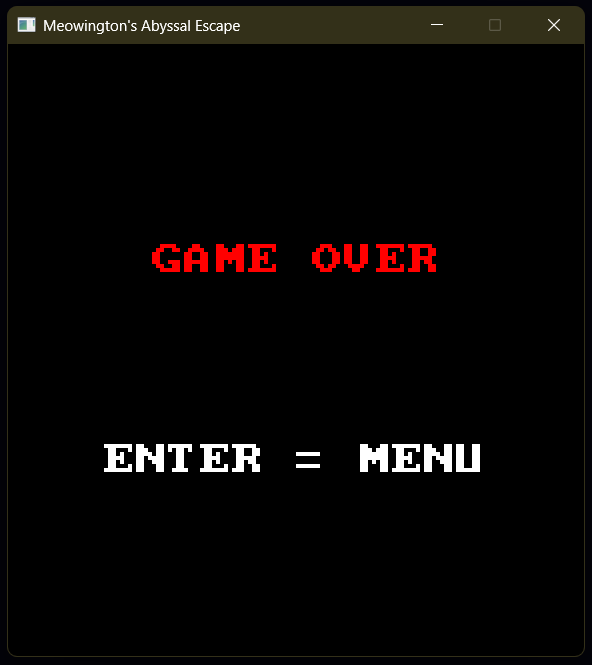

# Meowington's Abyssal Escape

A grid-based puzzle game in C++ and SDL3. Meowington has fallen into the abyss and must get home by picking up and placing blocks to build a path across the dark. This README is also the project report.
## Dependencies and how to run

**Dependencies:** SDL3, as used in the labs. No other libraries.

**To run the game (no Visual Studio needed):** open the `Meowington's Abyssal Escape v1.0` folder from the submission zip and double-click `MeowingtonsAbyssalEscape.exe`. The exe, `SDL3.dll` and the `levels` folder must stay together in the same folder.

**To build from source:** open the solution in Visual Studio 2022, set the configuration to x64 Release and build. SDL3 is included in the `SDL3` folder and referenced with relative paths, so no extra setup is needed. Run it from Visual Studio so the `\levels` folder is found.

A ready-to-run copy is also on the Releases page. Unzip it, keep the folder structure the same like above and run the exe.
## Initial Proposal:
Game Title:
Meowington’s Abyssal Escape Genre- Grid-based puzzle game.

Synopsis:
Meowington has fallen into the abyss and must get home! Can you manipulate your environment to cross the darkness and escape? One wrong step could mean going all the way back to the beginning… 

Mechanics:
You start in a level equipped with only the ability to grab blocks and place them back down in order to cross the gap between your starting point and the exit. 
You can only move block to block in a set grid, up, down and left and right (X, -X and Y, -Y). 
You can only pick up and put down blocks in the direction you are facing. 
You need to build from the starting point and to the exit for each level, while trying not to fall or get stuck which, if you fall or reset, costs a life in which you only have 3 but these carry over during the run until you reach the end of the levels or you fail because you run out of life. 
When you run out of life the game resets to the beginning and the life resets to 3. 

Dynamics:
Because you can only grab and place in the direction you face, players will need to plan ahead. 
Because blocks you have already crossed can be picked up and placed ahead of you, players will need to reuse blocks. 
Because a fall or reset costs one of 3 lives that carry over the whole run, a rushed move gets more expensive later on, players will need to be cautious. 
Because running out of lives sends you back to the beginning, players will then learn the levels and get faster each run. 

Aesthetics:
The player will feel the challenge when they are tasked with thinking ahead. 
The player will feel resourceful when they need to reuse blocks, this again adds into the thinking ahead. 
The player will feel tension as one wrong move could send them over the edge and lose a life. 
The player will feel like they are getting better, as the time it takes, and how far they get, will improve as they replay the game.

Architecture Overview:
UML Sketch made using Excalidraw. 

I’ll be using C++ and SDL3. 

Development Roadmap:
Week one: Work on the initial prototype using placeholder assets, make sure we implement the above features and a test level as a minimum. 
Week two: User testing, iteration and asset creation. I’ll work on extra levels, content, strategy etc. With a focus on refining mechanics and creating more content for the game with crucial user feedback to guide me. 

AI Usage I will not be using any AI for this project, all assets and code will be created solely by me.
## Changes from the proposal

The proposal is above. The core of it is built as proposed: grab and place blocks in the direction you face, three lives that carry over between levels, a fall or reset costs a life, and the `State`, `Event Queue` and `BlockType` parts of the architecture. There were only a few small changes within the architecture that made sense as I was developing:

- **`Grid` class became a plain array** (`BlockType grid[16][16]` in `PlayState`). The rules are a few lines each, so a class would have added files without adding behaviour.
- **`Command System` was not built.** The game didn't need undo, replay or key rebinding, so input is one `switch` in `PlayState::handleEvent`.
- **`Player` is a simple struct** with position, facing and held block, with no move states, since a key press moves one tile straight away.
- **`LifeSystem` and `SaveSystem` became simple code rather than classes.** `lives` is an `int` in `PlayState`, and at zero lives a Game Over screen shows before the menu, so the player sees what happened. Saving and continuing are a few functions in `LevelSave.cpp`.
- **No asset creation.** Tiles are coloured rectangles and text uses SDL's built-in font. I prioritised the feedback fixes and the code structure over art.

## Gameplay

Meowington starts on the start tile and must reach the green exit tile. Any tile that is not a block is a drop into the abyss.

| Key                   | Action                                                                                                 |
| --------------------- | ------------------------------------------------------------------------------------------------------ |
| W A S D or arrow keys | Move one tile and face that way                                                                        |
| Z                     | Pick up the block in front of you, or place the one you are holding onto an empty tile in front of you |
| R                     | Reset the level (costs a life)                                                                         |
| Esc                   | In a level: save and go to the menu. On the menu: quit                                                 |
| Enter                 | New game (menu), back to the menu (Game Over and win screens)                                          |
| C                     | Continue a saved game (menu)                                                                           |

- Moving onto an empty tile or off the grid is a fall. A fall or pressing R costs a life, and the level restarts with every block back where it began.
- You face the way you last moved, so to face a gap you walk toward it along the blocks.
- You hold one block at a time. Blocks you have crossed can be picked up and reused.
- You have three lives for the whole run, carried from level to level. Running out shows "GAME OVER". Finishing the last level shows "YOU MADE IT HOME!".
- The HUD shows one red square per life, the level number, and a tile slot that fills white while you hold a block.
## Design patterns

**State (used)**:
`State` is an abstract class with `handleEvent`, `update`, `draw` and `onQuit`. `MenuState`, `PlayState` and `EndState` (Game Over and win) each implement their own keys, updates and drawing. `Game` holds the three as members and a non-owning `State* current`, and the loop in `main` just passes events, update and draw to `game.current`. A transition is assigning `game.current`. Before this the game flow was an enum of game states handled in `main`. Now each screen is in one place and a new screen means a new subclass.

**Event Queue (used)**:
`EventType` has `PlayerFell`, `LevelReset` and `LevelComplete`, and `EventQueue` wraps a `std::queue`. `PlayState::handleEvent` pushes an event when something happens, and `PlayState::update` reads them and decides the result: lose a life, reload the level, load the next one, or show Game Over or the win screen. It replaced two boolean flags. Key presses are ignored while an event is waiting, so nothing can happen after a fall in the same frame.

**Command, Object Pool and Component (considered, not used)**: 
Command would turn one `switch` into three classes without changing behaviour, because there is no undo or rebinding. If key rebinding or something like controller support were added, it would be the first thing to bring in. (but not a real consideration at this stage.) Nothing is created or destroyed while the game runs (the grid is a fixed array and the three states live for the whole program), so there is nothing to pool. There is one kind of entity, the player, so there is nothing to compose from components.
## Mechanics and how they are coded

| Mechanic                               | Where                                             | How                                                                                                                                                                                                                                                                                                                                     |
| -------------------------------------- | ------------------------------------------------- | --------------------------------------------------------------------------------------------------------------------------------------------------------------------------------------------------------------------------------------------------------------------------------------------------------------------------------------- |
| Levels loaded at runtime               | `loadLevel`, `readGrid`                           | Reads `levels/level_X.txt`: 16 lines of 16 characters, `.` empty tile, `#` active tile, `S` start tile, `E` exit tile. Missing or unknown characters are empty. There is no level count in the code, when the player reaches the exit, the game tries the next numbered file, so adding `level_3.txt` adds a level with no code change. |
| Movement and facing                    | `PlayState::handleEvent`                          | If the target tile is on the grid and not empty, the player moves there and then faces that way.                                                                                                                                                                                                                                        |
| Pick up and place                      | `PlayState::handleEvent` , `case SDLK_Z`          | Works out the tile in front of the character with the `dirX` and `dirY` arrays, indexed by `Direction`. Picks up an active (`#`) or start tile (`S`) when empty-handed. Places a block on an empty tile (`.`) when holding one.                                                                                                         |
| Falling, lives, reset, next level, win | `PlayState::handleEvent`, `PlayState::update`     | A fall or R pushes an event. `update` reads the event queue and applies the result. A missing next level file means the player has won.                                                                                                                                                                                                 |
| Save and continue                      | `saveGame`, `loadGame`, `PlayState::continueGame` | `savegame.txt` holds `level lives x y facing holding` and then the 16 tile rows, so moved blocks are saved too. It is written on Esc or when the window is closed, and deleted when you continue, so it can only be used once.                                                                                                          |
| Drawing                                | `PlayState::draw`, `drawCentered`                 | Tiles, the player (an orange square with a red marker on the side it faces), the HUD and centred text. 144x153 logical pixels, scaled 4x to a 576x612 window with SDL's integer scaling.                                                                                                                                                |

## Sample screens

 
 
## Error handling and test cases

The game uses return values and message boxes rather than C++ exceptions. If SDL, the window or the renderer fails to start, or `levels/level_1.txt` is missing, it shows an error message and exits cleanly. A missing next level file is treated as the end of the game. Short or unknown level rows become empty tiles. An invalid or missing save is rejected (level, lives, position and facing are checked) and Continue does nothing. Held keys are ignored. If the window is closed mid-game, the game is saved first.

Tests were run by hand on the final build. All passed.

| ID   | Test                                                                     | Expected result                                                                                  | Result |
| ---- | ------------------------------------------------------------------------ | ------------------------------------------------------------------------------------------------ | ------ |
| T-01 | Menu: press Enter                                                        | Level 1 loads with three hearts and "LV 1"                                                       | Pass   |
| T-02 | Move with WASD and the arrow keys along blocks                           | One tile per press, and the red marker faces that way                                            | Pass   |
| T-03 | Step onto an empty tile, or off the edge of the grid                     | One heart lost, level restarts on the start tile                                                 | Pass   |
| T-04 | Face a block and press Z, then face an empty tile and press Z            | Block picked up and HUD slot fills, then block placed and slot empties                           | Pass   |
| T-05 | Press Z when there is nothing to pick up or place                        | Nothing changes                                                                                  | Pass   |
| T-06 | Move some blocks, then press R                                           | One heart lost and every block is back where it started                                          | Pass   |
| T-07 | Lose all three lives                                                     | "GAME OVER", Enter returns to the menu, a new game starts at level 1 with three lives            | Pass   |
| T-08 | Reach the exit                                                           | Next level loads and lives are kept                                                              | Pass   |
| T-09 | Reach the exit of the last level                                         | "YOU MADE IT HOME!"                                                                              | Pass   |
| T-10 | Press Esc in a level, then C on the menu                                 | Level, lives, position, facing, held block and moved blocks restored, and `savegame.txt` deleted | Pass   |
| T-11 | Close the window mid-level, restart, press C                             | The game is restored as in T-10                                                                  | Pass   |
| T-12 | Change the first line of `savegame.txt` to `0 9 99 99 7 0`, then press C | Stays on the menu with no crash, and the Continue option disappears                              | Pass   |
| T-13 | Rename `levels/level_1.txt` and start the game                           | Error message box, then a clean exit                                                             | Pass   |
| T-14 | Rename `levels/level_2.txt` and finish level 1                           | The win screen shows instead of a crash                                                          | Pass   |
| T-15 | Hold down a movement key                                                 | Moves one tile only                                                                              | Pass   |

## Playtesting

I ran two playtesting cycles with the same two testers: friends who play puzzle games, anonymised as Tester A and Tester B. Cycle 1 tested the finished prototype and cycle 2 tested the build after the fixes.

**What was tested:** whether a new player could work out the controls and rules with no instructions, and what confused or frustrated them.

**Method:** each tester played on my laptop with no instructions while I watched and took observation notes. Afterwards I asked: what were you trying to do, what happened, what did you expect, and what did you enjoy? I summarised their answers into the feedback table below.

| Cycle | Date     | Build tested              | Outcome                                   |
| ----- | -------- | ------------------------- | ----------------------------------------- |
| 1     | 5th Nov  | The finished prototype    | 7 pieces of feedback: 4 fixed, 3 deferred |
| 2     | 10th Nov | The build after the fixes | Both testers were happy with it           |

**Cycle 1: feedback and changes.** The four fixes were made in one commit, linked below.

| ID  | Feedback                                                                                                                                           | Decision and change                                                                                                                                   | Commit                                                                                                         |
| --- | -------------------------------------------------------------------------------------------------------------------------------------------------- | ----------------------------------------------------------------------------------------------------------------------------------------------------- | -------------------------------------------------------------------------------------------------------------- |
| F1  | Falling gives no feedback, it just resets. A tester suggested a short moment of hovering before a fall, where pressing the opposite key avoids it. | **Deferred.** Retesters were happy without it, and a forgiveness window would soften the tension the design relies on.                                | None                                                                                                           |
| F2  | It isn't clear which tile Z will act on.                                                                                                           | **Deferred.** I tried a yellow outline on the tile in front. It looked cluttered at 9 pixels, and the current design was intuitive enough without it. | None                                                                                                           |
| F3  | It isn't clear that R costs a life.                                                                                                                | **Fixed.** The menu now says "R = RESET LEVEL &" and "FALL = -1 LIFE" in yellow.                                                                      | [3a50984](https://github.com/yuhyuhey/MeowingtonAbyssalEscape/commit/3a509841b27f1471992035db54caa287a4800088) |
| F4  | There is no level number on screen.                                                                                                                | **Fixed.** "LV n" in the centre of the HUD.                                                                                                           | [3a50984](https://github.com/yuhyuhey/MeowingtonAbyssalEscape/commit/3a509841b27f1471992035db54caa287a4800088) |
| F5  | There is no sound.                                                                                                                                 | **Deferred.** Sound was not in my proposal, and the retesters were happy without it.                                                                  | None                                                                                                           |
| F6  | The white square on the cat is confusing. The HUD would show a held block better.                                                                  | **Fixed.** The square is gone and a HUD slot fills white while you hold a block.                                                                      | [3a50984](https://github.com/yuhyuhey/MeowingtonAbyssalEscape/commit/3a509841b27f1471992035db54caa287a4800088) |
| F7  | I didn't know you could pick up the start block.                                                                                                   | **Fixed.** The start tile had a debug colour. It is now drawn like any other block.                                                                   | [3a50984](https://github.com/yuhyuhey/MeowingtonAbyssalEscape/commit/3a509841b27f1471992035db54caa287a4800088) |

**Cycle 2: retest.** The same two testers played the updated build, again with no instructions and with me taking notes. They were happy with it, which confirmed my decision to leave hover, the outline and sound deferred.

**Reflection:** most of the feedback was about what the game did not show rather than about the rules: that a reset costs a life, which level they were on, how to see what they were holding, which tile Z would act on, and that the start tile could be picked up. The fixes were small changes to what is drawn on screen. The three I deferred (hover, outline, sound) would each have cost more than they gave, and the retest backed that decision. The remaining limitations are listed below.

Limitations:
- Presentation is basic, although I think it adds to the charm: coloured rectangles, no sprites, animation or sound.
- There is no timer or best-run record, so "getting faster each run" is left to the player to notice.
- Playtesting was two cycles with two friends, so the sample is small. The deferred items (hover before a fall, a tile outline, sound) were not built.
## Evaluation

**What I set out to do.** I wanted to challenge myself with this module, because it isn't something I have done much of before, and this game felt fun and unique to make. I wanted the difficulty to come from the mechanics rather than from a level that is hard only because it takes a long time to finish, so the movement is deliberately a little awkward at first: you can only turn by moving, and you can only grab the tile in front of you. That encourages mastery, and the fun of learning it. One thing I enjoyed working out was the maths of the grid: every tile has an x and y, and I had to make sure it all added up, from converting a tile position to pixels (x and y times the 9-pixel tile size) to checking the player stays inside the 16x16 grid and finding the tile in front from the facing direction.

**What I achieved.** A complete, playable puzzle game built around the proposal's core: grab-and-place building, three lives carried across levels, and a fall or reset that makes every step count. Levels are plain text files loaded at runtime, so a new level needs no code change, and save and continue keeps the blocks the player has moved. I used two patterns, State and Event Queue, where they removed real awkwardness, and I explained why I left Command, Object Pool and Component out. Two playtesting cycles with two testers gave seven pieces of feedback in cycle 1: four led to fixes and three were deliberately deferred, each with a reason, and the testers were happy with the result in cycle 2. The manual tests all pass, including bad save files and missing level files.

**What I would do differently.**
- Split up `PlayState::handleEvent`, which has grown long, by moving the grid rules into a `Grid` class as in my proposal.
- Playtest with more people, and build the deferred items and real art and sound.
- Add a run timer, so that the proposal's "getting faster each run" can actually be seen.